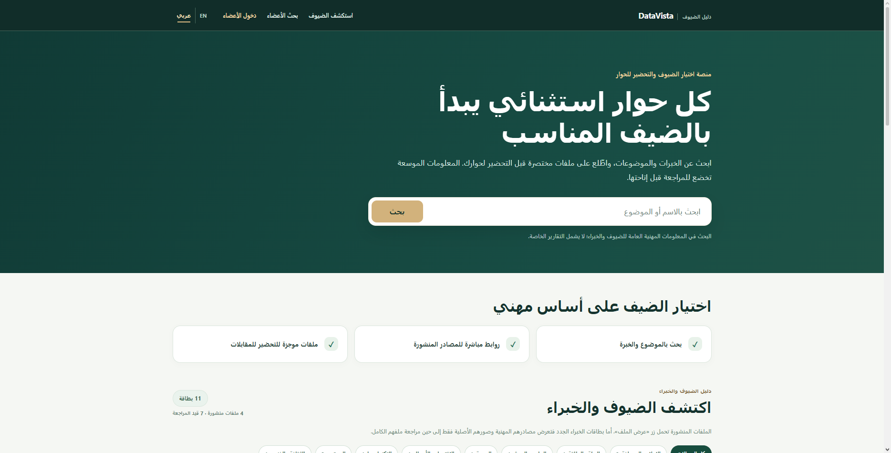
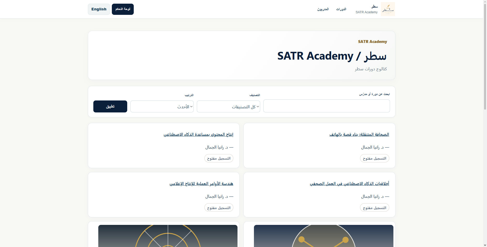

# DataVista Studio | داتافيستا

**أنظمة معلومات · تقنيات إعلامية · منتجات رقمية**

نطوّر أدوات تعمل فعليًا لفرق الإعلام والباحثين والمؤسسات والمدرّسين والمشغّلين.

[**استعرض المشاريع**](portfolio/README.ar.md) · [**English**](README.md) · [**الموقع**](https://datavista.studio/) · [**المؤسس**](https://github.com/arslanhq)

---

## أعمالنا أكبر من الموقع التعريفي

الموقع القديم لا يعرض كامل المشاريع الجديدة. هنا نُظهر المنتجات والمنصات الفعلية، مع توضيح ما هو منشور للعموم، وما لا يزال معاينة عامة، وما يحتاج إلى صلاحية دخول.

| المجال | المشاريع | طبيعة الوصول |
| --- | --- | --- |
| **الرصد والأخبار** | [Newsroom](https://datavista.studio/newsroom/) · [Observatories](https://datavista.studio/observatories/) · [FlashNews](https://datavista.studio/flashnews/) | واجهات عامة |
| **الضيوف والخبراء** | [People Report](https://datavista.studio/people_report/) · [الانضمام إلى Experts2](https://datavista.studio/experts2/join.php?lang=ar) | دليل وطلب انضمام عامان؛ الإدارة خاصة |
| **عمليات البث** | [CR Multiview](https://datavista.studio/cr/) · [Al Mayadeen Talk](https://meet.almayadeen.online/) | دخول للمشغلين |
| **التعليم والكتب** | [SATR Academy](https://datavista.studio/academy/) · [EBOOK](https://datavista.studio/ebook/) | كتالوجات عامة وعمليات محمية |
| **التجارة والمنصات** | [961.menu](https://961.menu/) · [DataVista Marketplace](https://datavista.studio/marketplace/) | خدمة ومنفذ معاينة للسوق |
| **الاقتصاد والبيانات** | [Stock](https://datavista.studio/stock/) · [Economy Desk](https://datavista.studio/economy-desk/) · [News Map](https://datavista.studio/newsmap/) | معلومات ومعاينات |
| **أعمال إضافية** | [Aparat](https://datavista.studio/aparat/) · [JobVista](https://datavista.studio/jobvista/) | واجهات عامة بمراحل مختلفة |

**[دليل الأعمال المفصّل ←](portfolio/README.ar.md)** · **[جولة مرئية في الواجهات الحقيقية ←](portfolio/visual-tour.md)**

## صور من العمل الحقيقي

هذه **لقطات فعلية من واجهات عامة** بتاريخ 22 نوفمبر 2026، وليست صورًا مولّدة أو صورًا تزيينية.

*People Report: البحث عن الضيوف والخبراء واستعراض المعلومات المهنية المنشورة.*

*SATR Academy: كتالوج الدورات، البحث والتصفية وارتباط الدورات بالمدرّسين.*

[**لقطات إضافية لنظام انضمام الضيوف ومعاينة السوق ←**](portfolio/visual-tour.md)

## طريقة العمل

- **حلول عملية:** أدوات للبحث والمراجعة والرصد وإدارة العمليات، لا صفحات ترويجية فقط.
- **لغة مناسبة:** العربية والإنجليزية بحسب طبيعة المنتج.
- **التحقق من البيانات:** توثيق المصادر وحالة المراجعة عندما تسمح طبيعة العمل.
- **حماية الأصول:** لا ننشر بيانات العملاء أو محتوى التشغيل الخاص أو مفاتيح الأنظمة أو الشيفرة التجارية.

## تواصل وتعاون

تأسّس DataVista Studio في بيروت، لبنان، على يد [**Mohammad Arslan**](https://github.com/arslanhq).

للتعاون في المنتجات الإعلامية والبيانات والخدمات الرقمية والحلول الخاصة:

**[الموقع الرسمي](https://datavista.studio/) · [تواصل معنا](https://datavista.studio/contact)**

---

عرض المنتجات للعامة لا يعني إتاحة شيفرتها أو بياناتها لإعادة الاستخدام. تختلف حالة الإطلاق والصلاحيات بين منصة وأخرى. الصور من الواجهات العامة في تاريخ الالتقاط المذكور.
