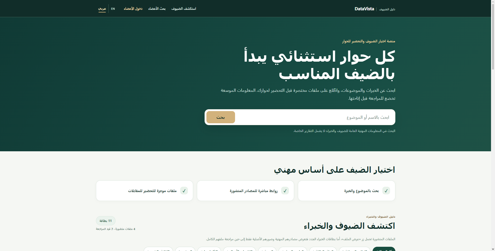
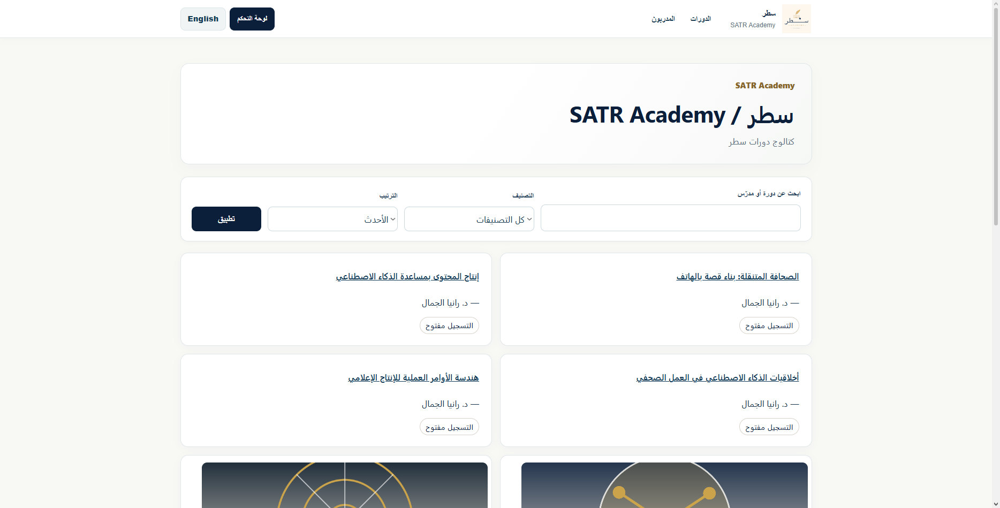

# DataVista Studio

**Information systems · Media technology · Digital products**

We build working tools for media teams, researchers, businesses, educators and operators.

[**Explore the work**](portfolio/README.md) · [**Arabic / العربية**](README.ar.md) · [**Website**](https://datavista.studio/) · [**Founder**](https://github.com/arslanhq)

---

## Products, not just a website

The original company website does not capture the full scope of recent work. This portfolio documents current products and newer engineering projects individually, including projects with private back offices and public-facing previews.

| Area | Actual work | Access |
| --- | --- | --- |
| **Media monitoring** | [DataVista Newsroom](https://datavista.studio/newsroom/), [Observatories](https://datavista.studio/observatories/), [FlashNews](https://datavista.studio/flashnews/) | Public interfaces |
| **Media guest discovery** | [People Report](https://datavista.studio/people_report/) and [Experts2 / guest applications](https://datavista.studio/experts2/join.php?lang=ar) | Public directory and application; editorial operations private |
| **Broadcast operations** | [CR Multiview](https://datavista.studio/cr/) and [Al Mayadeen Talk](https://meet.almayadeen.online/) | Operator / authenticated access |
| **Learning and publishing** | [SATR Academy](https://datavista.studio/academy/), [DataVista EBOOK](https://datavista.studio/ebook/) | Public catalogues; some workflows require access |
| **Commerce** | [961.menu](https://961.menu/), [DataVista Marketplace](https://datavista.studio/marketplace/) | Live service / separate public marketplace preview |
| **Market and data tools** | [DataVista Stock](https://datavista.studio/stock/), [Economy Desk](https://datavista.studio/economy-desk/), [News Map](https://datavista.studio/newsmap/) | Public information / preview tools |
| **Other current work** | [Aparat language bridge](https://datavista.studio/aparat/), [JobVista](https://datavista.studio/jobvista/) | Public interfaces; maturity varies |

**[Browse the detailed project directory →](portfolio/README.md)** · **[Real interface walkthrough →](portfolio/visual-tour.md)**

## Inside current interfaces

The images below are **real screenshots of publicly accessible DataVista pages captured on 22 November 2026**. They illustrate specific product screens rather than generic stock artwork.

*People Report: find public guest profiles and review published professional information.*

*SATR: course catalogue with search, filtering and instructor-linked training.*

[**See the guest application and marketplace preview screenshots →**](portfolio/visual-tour.md)

## What differentiates our work

**Working interfaces.** Research, input, discovery, review, monitoring and operational workflows — not just landing pages.

**Arabic and English.** Products designed for the languages and formats they serve.

**Source context.** Where relevant, we keep links, provenance and review status visible.

**Responsible boundaries.** Public demonstrations do not expose private media streams, customer data, credentials, unreleased commercial code or production systems.

## Collaboration

DataVista Studio is based in Beirut, Lebanon, and founded by [**Mohammad Arslan**](https://github.com/arslanhq).

We are open to conversations about media workflows, product partnerships, data applications, custom implementations and licensed deployments.

**[Website](https://datavista.studio/) · [Contact](https://datavista.studio/contact)**

---

Public-facing product descriptions are not open-source licenses. Product readiness and access conditions vary. Screenshots represent the public interface on the stated capture date.
