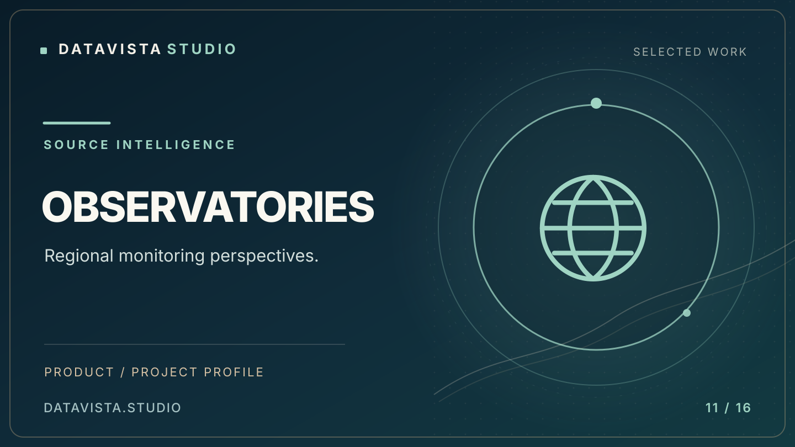
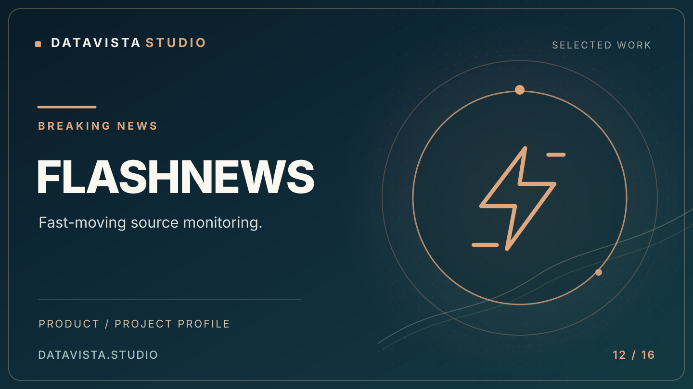
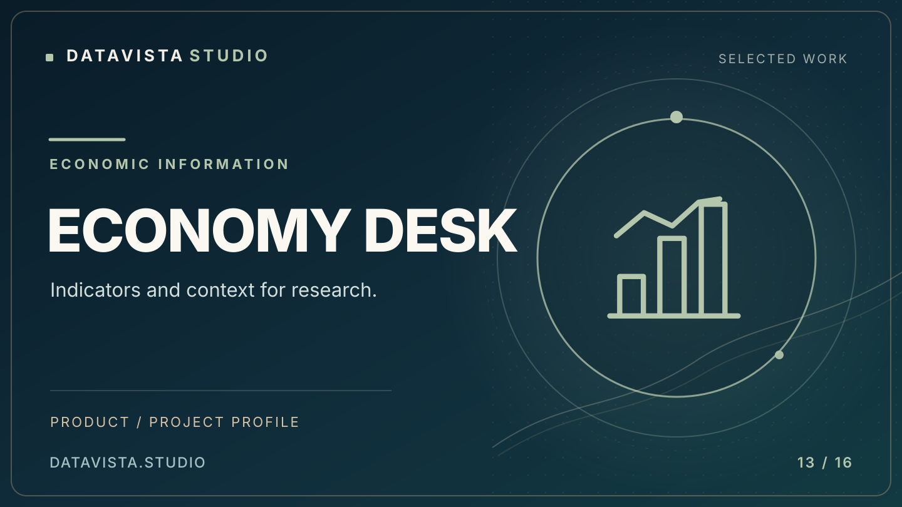
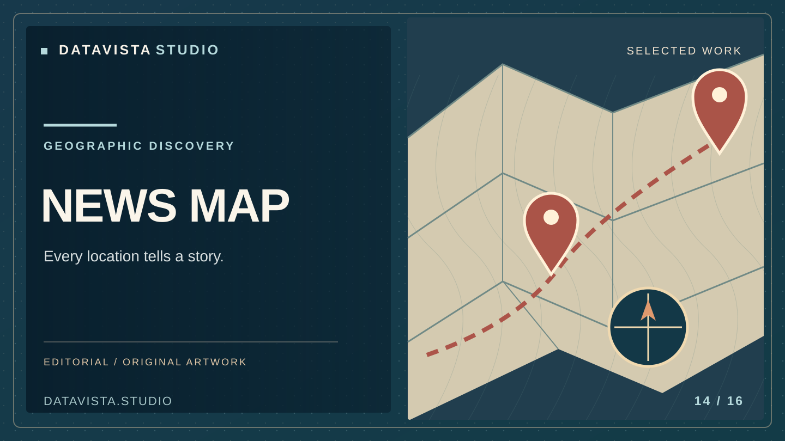
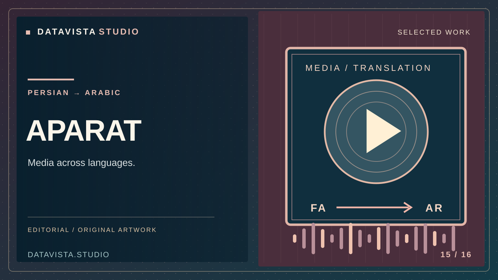
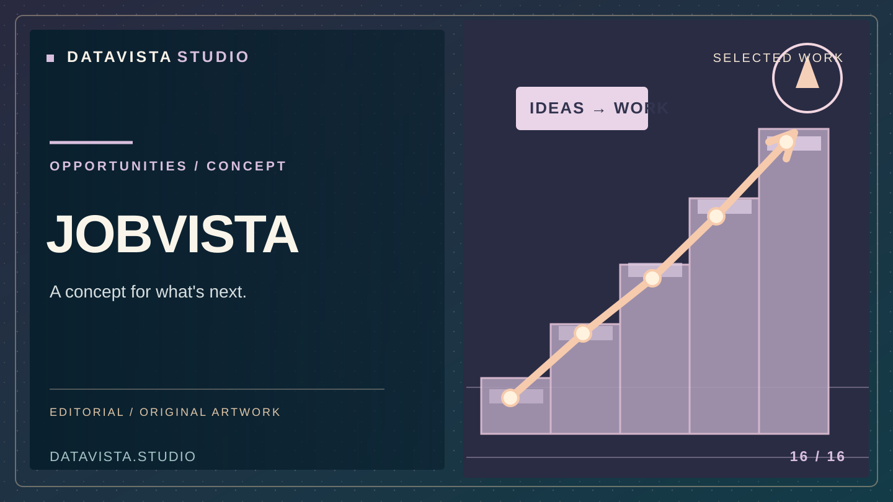

# دليل مشاريع DataVista Studio

[← واجهة الشركة](../README.ar.md) · [English](README.md) · [معرض الصور](visual-tour.md)

**16 مشروعًا ومنتجًا**، لكل مشروع تكوين فني مخصص: 10 بطاقات تحريرية مصوّرة و6 رسوم متجهية فنية جديدة، ضمن هوية متناسقة. لا نستخدم لقطات شاشة للمواقع.

<table><tbody>
<tr>
<td align="left" valign="top" width="50%">

<strong>NEWSROOM</strong> · عام 
الأخبار العاجلة والمصادر والأرشيف. 
<a href="https://datavista.studio/newsroom/">رابط المشروع</a>

</td>
<td align="left" valign="top" width="50%">

<strong>Market.961.MENU</strong> · قيد التجهيز 
سوق إعلانات لبناني — قيد التجهيز. 
<a href="https://market.961.menu/">رابط المشروع</a>

</td>
</tr>
<tr>
<td align="left" valign="top" width="50%">

<strong>PEOPLE REPORT</strong> · دليل عام 
البحث عن الضيوف والتحضير المهني للمقابلات. 
<a href="https://datavista.studio/people_report/">رابط المشروع</a>

</td>
<td align="left" valign="top" width="50%">

<strong>EXPERTS2</strong> · تقديم عام 
طلبات الانضمام وتصنيف الخبرات والظهور الإعلامي. 
<a href="https://datavista.studio/experts2/join.php?lang=ar">رابط المشروع</a>

</td>
</tr>
<tr>
<td align="left" valign="top" width="50%">

<strong>CR MULTIVIEW</strong> · مقيّد 
متابعة مصادر البث والتسجيل والتحكم. 
<a href="https://datavista.studio/cr/">رابط المشروع</a>

</td>
<td align="left" valign="top" width="50%">

<strong>SATR ACADEMY</strong> · كتالوج عام 
الدورات والمدربون ومسارات التعلم. 
<a href="https://datavista.studio/academy/">رابط المشروع</a>

</td>
</tr>
<tr>
<td align="left" valign="top" width="50%">

<strong>EBOOK LIBRARY</strong> · مكتبة عامة 
كتب ومؤلفون عرب وسجلات مرتبطة بالمصادر. 
<a href="https://datavista.studio/ebook/">رابط المشروع</a>

</td>
<td align="left" valign="top" width="50%">

<strong>DATAVISTA STOCK</strong> · معاينة 
استكشاف الأصول والأسواق؛ ليست منصة تداول. 
<a href="https://datavista.studio/stock/">رابط المشروع</a>

</td>
</tr>
<tr>
<td align="left" valign="top" width="50%">

<strong>961.MENU</strong> · خدمة متاحة 
صفحات محلات وقوائم رقمية وطلبات. 
<a href="https://961.menu/">رابط المشروع</a>

</td>
<td align="left" valign="top" width="50%">

<strong>AL MAYADEEN TALK</strong> · مقيّد 
غرف مقابلات وأدوات إنتاج إعلامي. 
<a href="https://meet.almayadeen.online/">رابط المشروع</a>

</td>
</tr>
<tr>
<td align="left" valign="top" width="50%">

<strong>OBSERVATORIES</strong> · عام 
مراصد إعلامية بحسب المناطق والمصادر. 
<a href="https://datavista.studio/observatories/">رابط المشروع</a>

</td>
<td align="left" valign="top" width="50%">

<strong>FLASHNEWS</strong> · عام 
متابعة سريعة لتدفق الأخبار. 
<a href="https://datavista.studio/flashnews/">رابط المشروع</a>

</td>
</tr>
<tr>
<td align="left" valign="top" width="50%">

<strong>ECONOMY DESK</strong> · عام 
معلومات اقتصادية ومراجع للبحث. 
<a href="https://datavista.studio/economy-desk/">رابط المشروع</a>

</td>
<td align="left" valign="top" width="50%">

<strong>NEWS MAP</strong> · عام 
عرض الأخبار بحسب الموقع والجغرافيا. 
<a href="https://datavista.studio/newsmap/">رابط المشروع</a>

</td>
</tr>
<tr>
<td align="left" valign="top" width="50%">

<strong>APARAT</strong> · واجهة عامة 
سير عمل ترجمة المواد الفارسية للعربية. 
<a href="https://datavista.studio/aparat/">رابط المشروع</a>

</td>
<td align="left" valign="top" width="50%">

<strong>JOBVISTA</strong> · تصوّر 
تصوّر للوظائف والاختصاصيين. 
<a href="https://datavista.studio/jobvista/">رابط المشروع</a>

</td>
</tr>
</tbody></table>

## حالة الإطلاق والخصوصية

**عام** يعني وجود واجهة عامة؛ **مقيّد** يعني صلاحية دخول؛ **معاينة** أو **قيد التجهيز** لا تعني إطلاقًا تجاريًا كاملًا؛ **تصوّر** يعني مشروعًا استكشافيًا.

تم اعتماد الاسم العام **Market.961.MENU** بدل اسم Marketplace السابق، ورابطه الحالي هو [market.961.menu](https://market.961.menu/). مستودعات العمل الخاصة وبيئة الاختبار لم تتغير.

البطاقات تصميم تعريفي وليست نسخًا من واجهات المنتجات. عرض المشروع لا يجيز استخدام شيفرته أو بياناته أو محتواه المحمي.
