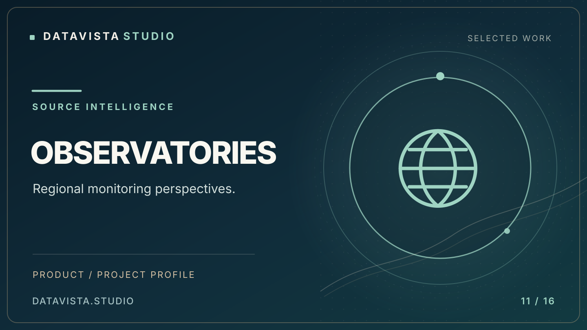
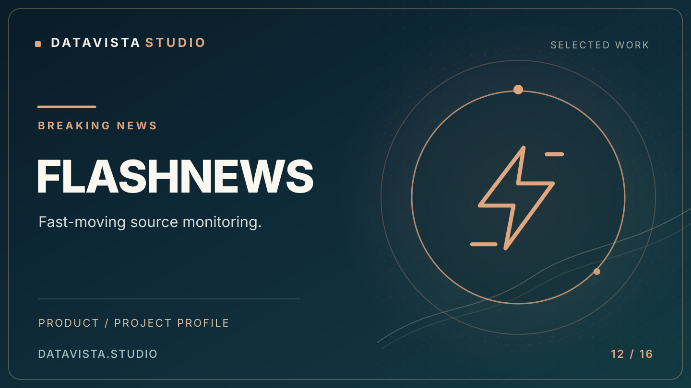
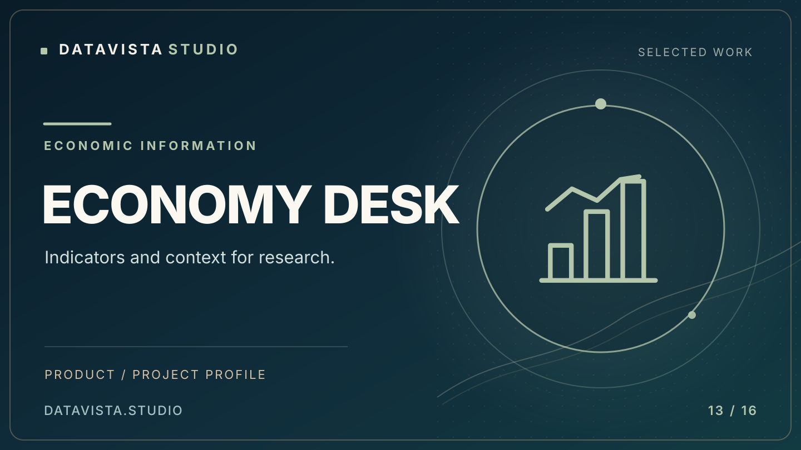
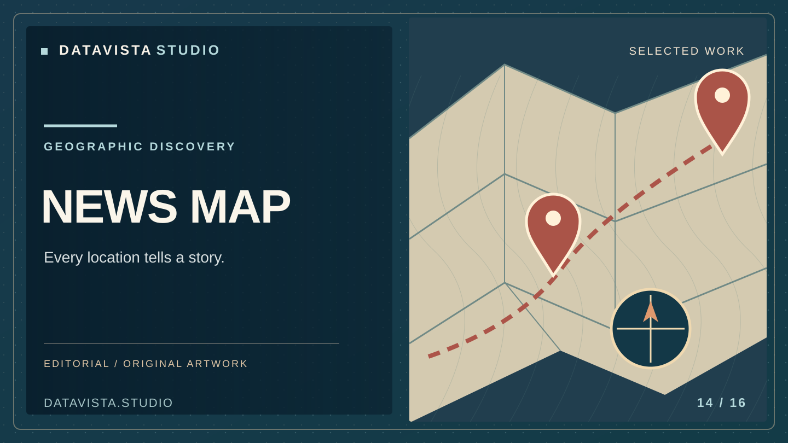
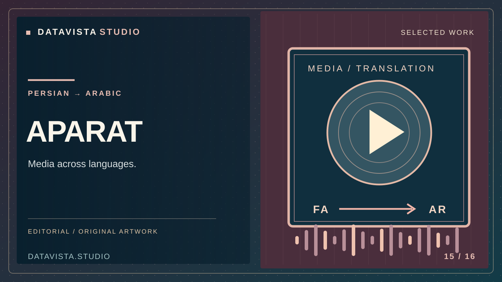
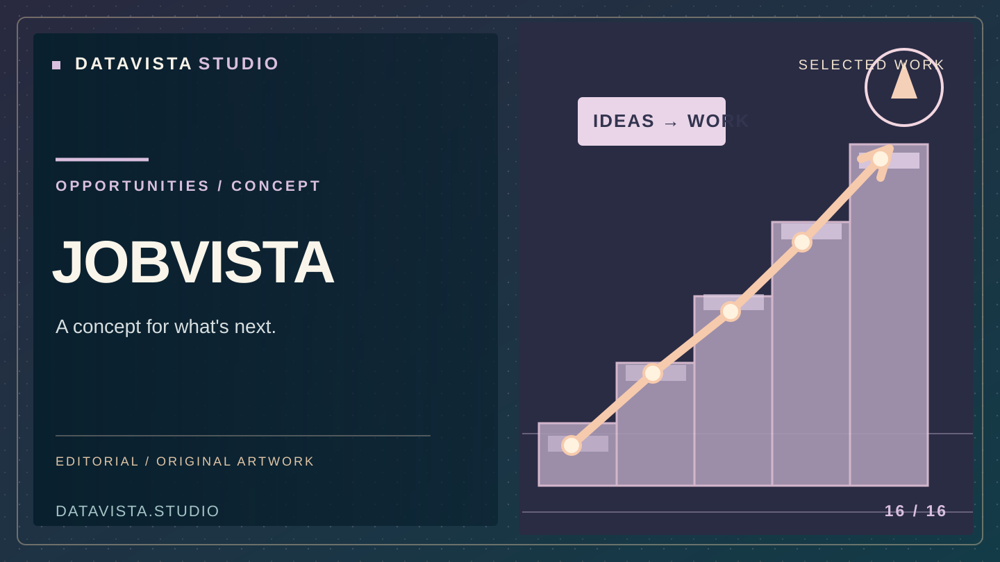

# DataVista Studio — Projects

[← Main profile](../README.md) · [العربية](README.ar.md) · [Visual card gallery](visual-tour.md)

**16 products and selected projects**, each with its own art-directed composition: 10 photographic-style editorial cards and 6 bespoke vector artworks. All use coordinated formats and typography; none is a screenshot of a live interface.

<table><tbody>
<tr>
<td align="left" valign="top" width="50%">

<strong>NEWSROOM</strong> · Public 
Live news and source monitoring. 
<a href="https://datavista.studio/newsroom/">Project link</a>

</td>
<td align="left" valign="top" width="50%">

<strong>Market.961.MENU</strong> · Coming soon 
Lebanon marketplace — preparing for launch. 
<a href="https://market.961.menu/">Project link</a>

</td>
</tr>
<tr>
<td align="left" valign="top" width="50%">

<strong>PEOPLE REPORT</strong> · Public directory 
Verified guest research and interview preparation. 
<a href="https://datavista.studio/people_report/">Project link</a>

</td>
<td align="left" valign="top" width="50%">

<strong>EXPERTS2</strong> · Public application 
Guest applications and expertise matching. 
<a href="https://datavista.studio/experts2/join.php?lang=ar">Project link</a>

</td>
</tr>
<tr>
<td align="left" valign="top" width="50%">

<strong>CR MULTIVIEW</strong> · Restricted 
Broadcast multiview and controlled recording. 
<a href="https://datavista.studio/cr/">Project link</a>

</td>
<td align="left" valign="top" width="50%">

<strong>SATR ACADEMY</strong> · Public catalogue 
Courses, instructors and education workflows. 
<a href="https://datavista.studio/academy/">Project link</a>

</td>
</tr>
<tr>
<td align="left" valign="top" width="50%">

<strong>EBOOK LIBRARY</strong> · Public catalogue 
Source-linked Arabic books and authors. 
<a href="https://datavista.studio/ebook/">Project link</a>

</td>
<td align="left" valign="top" width="50%">

<strong>DATAVISTA STOCK</strong> · Preview 
Asset discovery and market information. 
<a href="https://datavista.studio/stock/">Project link</a>

</td>
</tr>
<tr>
<td align="left" valign="top" width="50%">

<strong>961.MENU</strong> · Live service 
Digital merchant pages, menus and orders. 
<a href="https://961.menu/">Project link</a>

</td>
<td align="left" valign="top" width="50%">

<strong>AL MAYADEEN TALK</strong> · Restricted 
Interviews and live media production workflows. 
<a href="https://meet.almayadeen.online/">Project link</a>

</td>
</tr>
<tr>
<td align="left" valign="top" width="50%">

<strong>OBSERVATORIES</strong> · Public 
Regional media and news-source monitoring. 
<a href="https://datavista.studio/observatories/">Project link</a>

</td>
<td align="left" valign="top" width="50%">

<strong>FLASHNEWS</strong> · Public 
Rapid breaking-news monitoring. 
<a href="https://datavista.studio/flashnews/">Project link</a>

</td>
</tr>
<tr>
<td align="left" valign="top" width="50%">

<strong>ECONOMY DESK</strong> · Public 
Economic information and research context. 
<a href="https://datavista.studio/economy-desk/">Project link</a>

</td>
<td align="left" valign="top" width="50%">

<strong>NEWS MAP</strong> · Public 
Explore news geographically. 
<a href="https://datavista.studio/newsmap/">Project link</a>

</td>
</tr>
<tr>
<td align="left" valign="top" width="50%">

<strong>APARAT</strong> · Public interface 
Persian-to-Arabic translated media workflows. 
<a href="https://datavista.studio/aparat/">Project link</a>

</td>
<td align="left" valign="top" width="50%">

<strong>JOBVISTA</strong> · Concept 
Jobs and specialists discovery concept. 
<a href="https://datavista.studio/jobvista/">Project link</a>

</td>
</tr>
</tbody></table>

## Access and publishing policy

**Public** is a public-facing site; **Restricted** requires authorized access; **Preview** and **Coming soon** do not imply commercial launch; **Concept** is exploratory.

Market.961.MENU is the official name used for this portfolio entry. We use [https://market.961.menu/](https://market.961.menu/) as its current public address. The restricted project source and staging environment are separate and unchanged.

Product links are not open-source licenses. We do not share sensitive operational screenshots, customer records, private source code or licensed third-party media in the portfolio.
