# DataVista Studio — Visual identity and project cards

[English project directory](README.md) · [الدليل بالعربية](README.ar.md) · [Company profile](../README.md)

## The artwork

These **16 consistent vector cards** are editorial illustrations: one size, one typography system, an elegant navy/bronze palette and a distinct symbol for each project. **They are not screenshots or evidence of a shipped user interface.**

<table><tbody>
<tr>
<td align="left" valign="top" width="50%">
<a href="https://datavista.studio/newsroom/">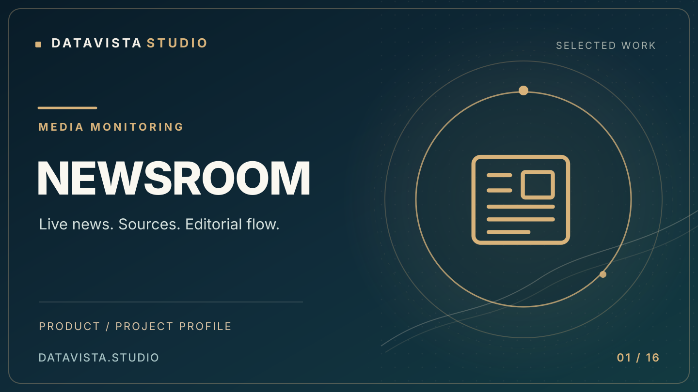</a>

<strong>NEWSROOM</strong> · Public 
Live news and source monitoring. 
<a href="https://datavista.studio/newsroom/">Project link</a>

</td>
<td align="left" valign="top" width="50%">
<a href="https://market.961.menu/">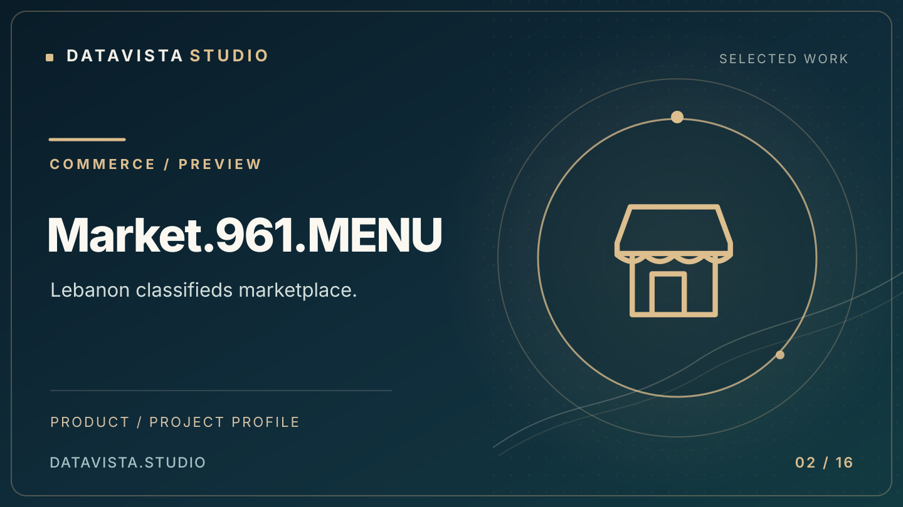</a>

<strong>Market.961.MENU</strong> · Coming soon 
Lebanon marketplace — preparing for launch. 
<a href="https://market.961.menu/">Project link</a>

</td>
</tr>
<tr>
<td align="left" valign="top" width="50%">
<a href="https://datavista.studio/people_report/">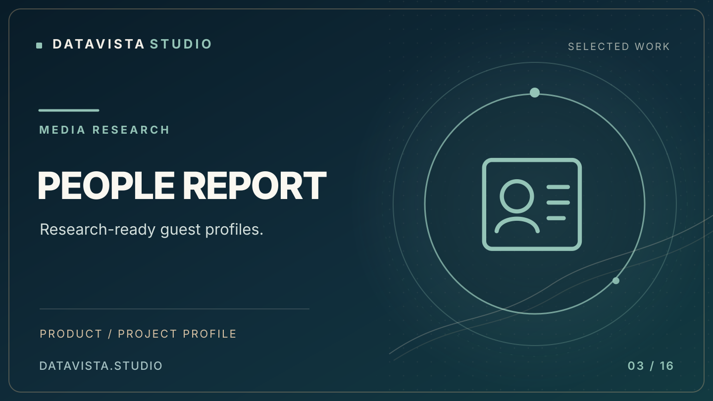</a>

<strong>PEOPLE REPORT</strong> · Public directory 
Verified guest research and interview preparation. 
<a href="https://datavista.studio/people_report/">Project link</a>

</td>
<td align="left" valign="top" width="50%">
<a href="https://datavista.studio/experts2/join.php?lang=ar">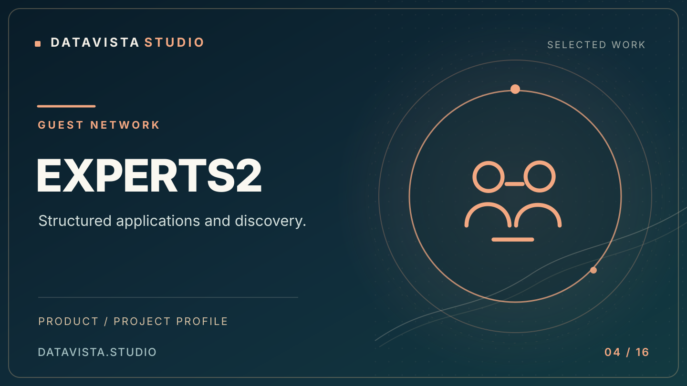</a>

<strong>EXPERTS2</strong> · Public application 
Guest applications and expertise matching. 
<a href="https://datavista.studio/experts2/join.php?lang=ar">Project link</a>

</td>
</tr>
<tr>
<td align="left" valign="top" width="50%">
<a href="https://datavista.studio/cr/">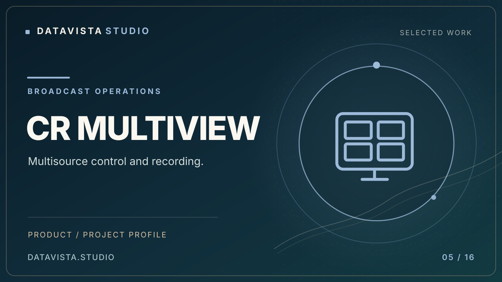</a>

<strong>CR MULTIVIEW</strong> · Restricted 
Broadcast multiview and controlled recording. 
<a href="https://datavista.studio/cr/">Project link</a>

</td>
<td align="left" valign="top" width="50%">
<a href="https://datavista.studio/academy/">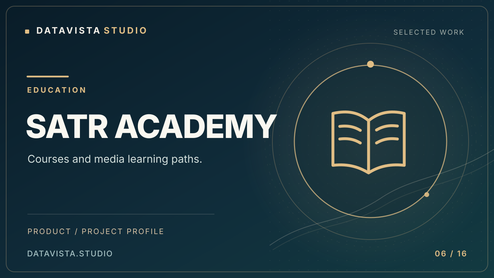</a>

<strong>SATR ACADEMY</strong> · Public catalogue 
Courses, instructors and education workflows. 
<a href="https://datavista.studio/academy/">Project link</a>

</td>
</tr>
<tr>
<td align="left" valign="top" width="50%">
<a href="https://datavista.studio/ebook/">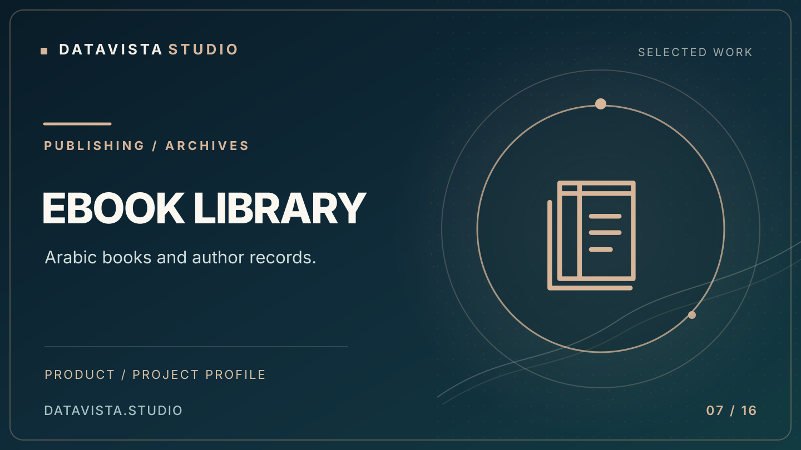</a>

<strong>EBOOK LIBRARY</strong> · Public catalogue 
Source-linked Arabic books and authors. 
<a href="https://datavista.studio/ebook/">Project link</a>

</td>
<td align="left" valign="top" width="50%">
<a href="https://datavista.studio/stock/">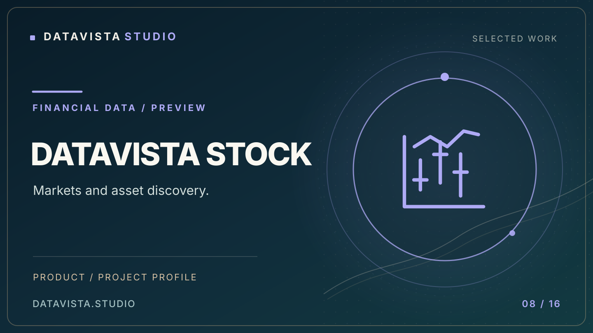</a>

<strong>DATAVISTA STOCK</strong> · Preview 
Asset discovery and market information. 
<a href="https://datavista.studio/stock/">Project link</a>

</td>
</tr>
<tr>
<td align="left" valign="top" width="50%">
<a href="https://961.menu/">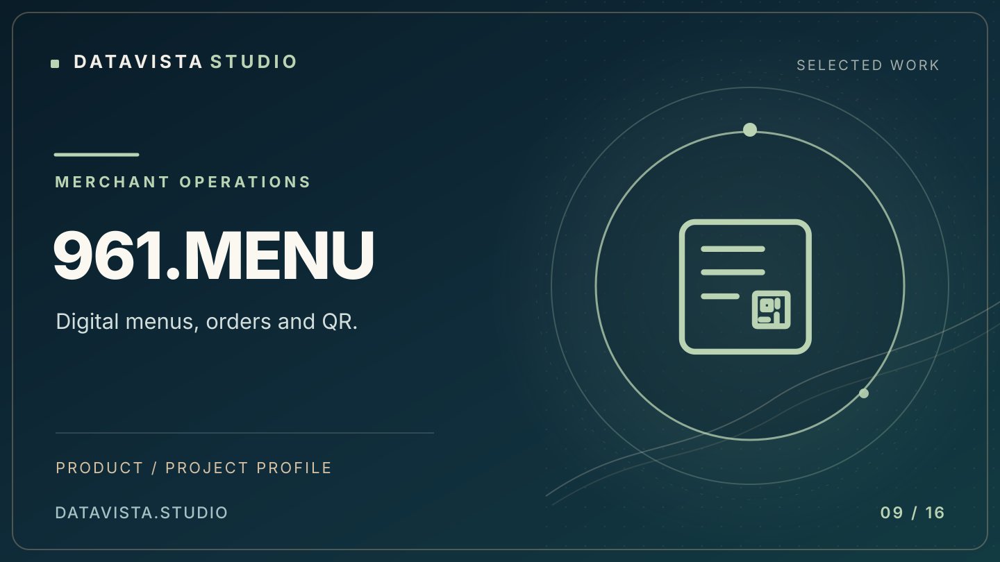</a>

<strong>961.MENU</strong> · Live service 
Digital merchant pages, menus and orders. 
<a href="https://961.menu/">Project link</a>

</td>
<td align="left" valign="top" width="50%">
<a href="https://meet.almayadeen.online/">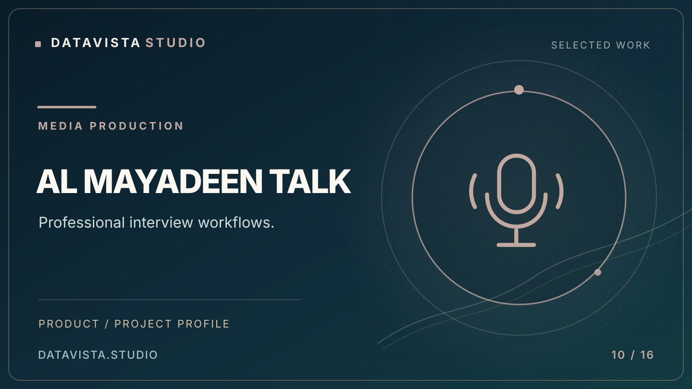</a>

<strong>AL MAYADEEN TALK</strong> · Restricted 
Interviews and live media production workflows. 
<a href="https://meet.almayadeen.online/">Project link</a>

</td>
</tr>
<tr>
<td align="left" valign="top" width="50%">
<a href="https://datavista.studio/observatories/">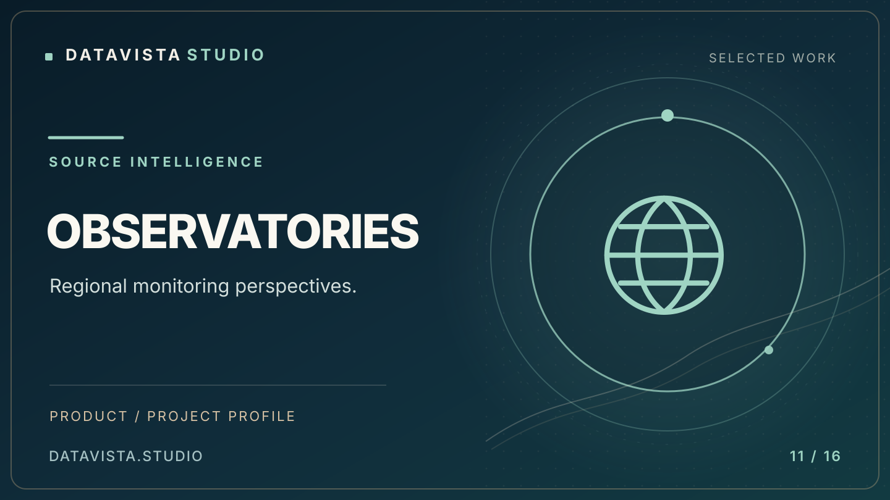</a>

<strong>OBSERVATORIES</strong> · Public 
Regional media and news-source monitoring. 
<a href="https://datavista.studio/observatories/">Project link</a>

</td>
<td align="left" valign="top" width="50%">

<strong>FLASHNEWS</strong> · Public 
Rapid breaking-news monitoring. 
<a href="https://datavista.studio/flashnews/">Project link</a>

</td>
</tr>
<tr>
<td align="left" valign="top" width="50%">

<strong>ECONOMY DESK</strong> · Public 
Economic information and research context. 
<a href="https://datavista.studio/economy-desk/">Project link</a>

</td>
<td align="left" valign="top" width="50%">
<a href="https://datavista.studio/newsmap/">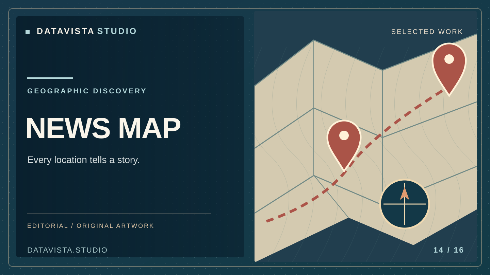</a>

<strong>NEWS MAP</strong> · Public 
Explore news geographically. 
<a href="https://datavista.studio/newsmap/">Project link</a>

</td>
</tr>
<tr>
<td align="left" valign="top" width="50%">
<a href="https://datavista.studio/aparat/">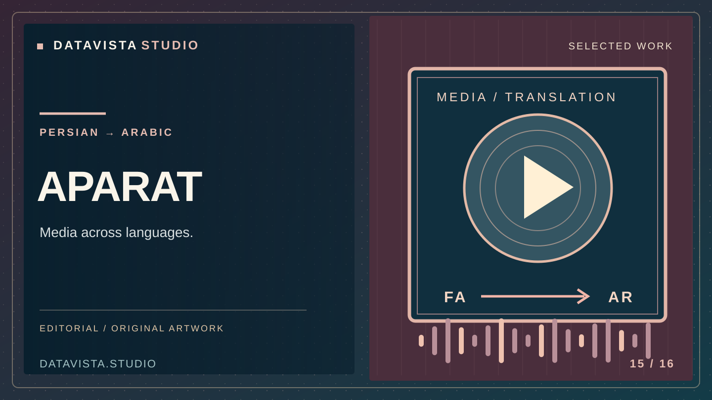</a>

<strong>APARAT</strong> · Public interface 
Persian-to-Arabic translated media workflows. 
<a href="https://datavista.studio/aparat/">Project link</a>

</td>
<td align="left" valign="top" width="50%">

<strong>JOBVISTA</strong> · Concept 
Jobs and specialists discovery concept. 
<a href="https://datavista.studio/jobvista/">Project link</a>

</td>
</tr>
</tbody></table>

## Design rules

- Maintain consistent 16:9 card dimensions, typography, spacing and outer framing.
- Use original geometric vector motifs; no screenshots, synthetic software mockups or unrelated stock images.
- Use the official project label: **NEWSROOM** and **Market.961.MENU**.
- Describe product access honestly: public, restricted, preview, concept or preparing for launch.
- Do not add private assets, credentials or people's identifying records.

## ملاحظات بالعربية

هذه رسومات توضيحية خاصة بكل مشروع، وليست صورًا مأخوذة من المواقع. تم توحيد حجم البطاقة والخطوط والألوان، مع تخصيص رمز يدل على وظيفة المشروع. **Market.961.MENU** ما زال «قيد التجهيز».
