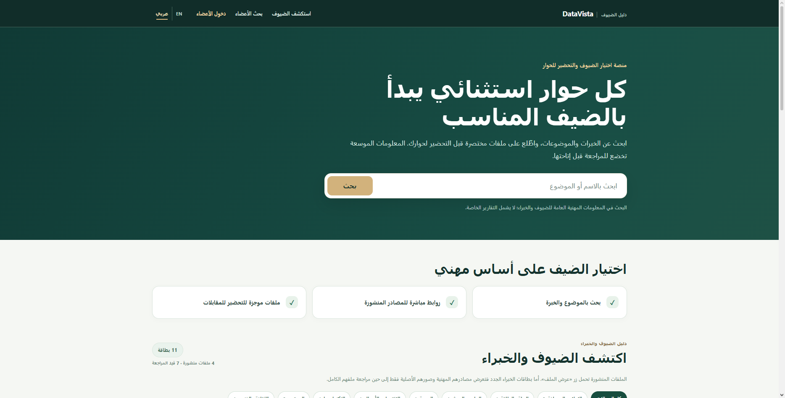
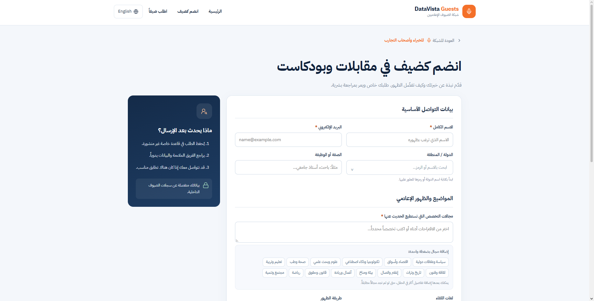
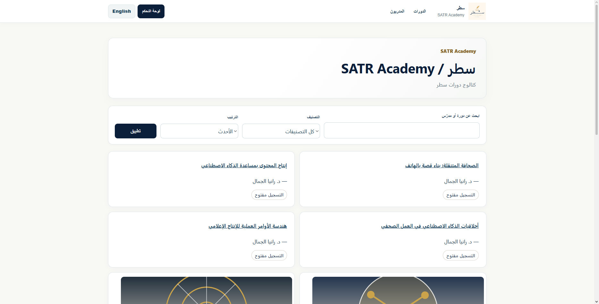
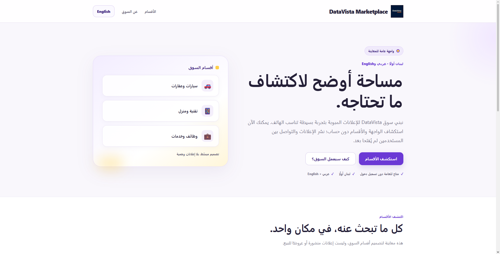

# Actual product interfaces — visual tour

[← Projects](README.md) · [الرئيسية](../README.ar.md)

**Source:** Screenshots of DataVista's **public web interfaces**, captured on **22 November 2026**. These are not generated mockups or private/admin screenshots. Each image shows a real screen and a specific workflow. Features and data can change over time.

## 1. People Report — guest research

**Purpose:** Let media teams search a public professional directory, review published guest information and prepare an interview with relevant context.

**What this screenshot demonstrates:** dedicated search, guest-expertise discovery and an explicit separation between published profiles and private reports. It does not represent access to private editorial records.

**[Open the public directory](https://datavista.studio/people_report/)**

## 2. Experts2 — a structured guest application

**Purpose:** Help prospective guests submit expertise and media-appearance preferences in structured fields rather than a loosely formatted message.

**What this screenshot demonstrates:** a guided application, fields for contact and professional background, suggested topic categories and a visible explanation of the editorial review step. The form is public; reviewer operations are private.

**[Open the guest application](https://datavista.studio/experts2/join.php?lang=ar)**

## 3. SATR Academy — course discovery

**Purpose:** Make a professional-learning catalogue searchable and navigable, with published courses associated with instructors.

**What this screenshot demonstrates:** the publicly visible course list, search, sorting and course entry points. It does not assert that every lesson or private learner function has passed release acceptance.

**[Open the catalogue](https://datavista.studio/academy/public/catalog.php?lang=ar)**

## 4. Marketplace — a public preview, not launch evidence

**Purpose:** Present the proposed classifieds marketplace categories and mobile-first discovery direction.

**What this screenshot demonstrates:** public-facing categories and design. **It is explicitly a preview**; it does not demonstrate live transactions, public seller registration or the protected staging back office.

**[Open the public preview](https://datavista.studio/marketplace/)**

---

### العربية — ماذا تُظهر الصور؟

- **People Report:** البحث في دليل الضيوف المنشور والمعلومات المهنية العامة؛ التقارير الخاصة ليست ظاهرة.
- **Experts2:** نموذج انضمام موجّه للضيف، وحقول منظمة، ومراجعة بشرية قبل النشر.
- **SATR Academy:** كتالوج الدورات مع البحث والتصفية وروابط الدورات والمدربين.
- **Marketplace:** معاينة الأقسام والهوية البصرية، **وليست دليلًا على إطلاق تجاري كامل**.

**Why there are no screenshots of private media rooms, customer records or admin pages:** public portfolio photography must never become a route for exposing confidential material.

[Project list](README.md) · [DataVista Studio](../README.md)
